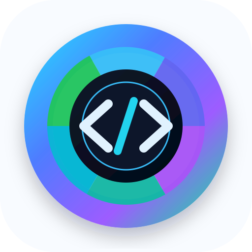
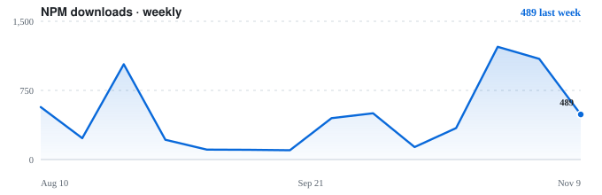

<p align="center"></p>
<h1 align="center">OpenCode Browser Plugin</h1>
<p align="center">Your browser, connected to your coding agent.<br>Four compact tools. Local action memory. Optional decision assistance.</p>
<p align="center">
<a href="https://www.npmjs.com/package/opencode-chromium"></a>
<a href="https://www.npmjs.com/package/opencode-chromium"></a>
<a href="https://github.com/Quindart-com/opencode-chromium/discussions"></a>
</p>
<p align="center">
<a href="https://chromewebstore.google.com/detail/opencode-chromium/hdljmmpfnhojebplbbgdgejoobmjcbml"></a>
<a href="https://addons.mozilla.org/firefox/addon/opencode-browser-plugin/"></a>
</p>

## Highlights

- **One small toolset for every agent.** `browser_run`, `browser_observe`, `browser_session` and `browser_finalize` work the same way in Codex, Claude Code, Claude Desktop, OpenCode 1.x and 2.x, DeepSeek Harness, any MCP client and the JavaScript SDK.
- **Pages read as compact text** *(new in 2.0.5)*. `browser_observe` mode `read` returns the page as short lines with `[ref]` targets, using far fewer tokens than a screenshot. A repeat read returns only what changed. Act on a ref directly with `target: { "ref": … }`.
- **Background tabs and guarded sites** *(new in 2.0.5)*. Agent tabs keep rendering without being brought forward, so several agents can work in parallel. Input uses genuine pointer and keyboard events, so sites that block devtools still work.
- **Your tabs stay yours** *(2.0.1)*. A session controls only the tabs it opened or that you let it claim. With the browser extension, finished work stays open in a blue group for your review.
- **Updates that never interrupt work** *(2.0)*. Each new release is checked before use. Sessions already running stay on their version until they finish. Rollback works the same way.
- **Local first.** Search and the optional action memory run on your machine. Cloud decision assistance and screenshot sharing stay off until you turn them on.

[What's new in each release →](https://quindart-com.github.io/opencode-chromium/updates/)

## Get started

For Chromium, Firefox, or LibreWolf, install the matching browser extension. For Ladybird, follow the [experimental setup instructions](#ladybird-agent-setup). To connect your agent app:

```sh
npx -y opencode-chromium@latest setup --all
```

Setup shows what changed and keeps transactional backups. Preview with `--dry-run --json`. Quit and reopen desktop harnesses, or reconnect MCP in terminal clients. **Firefox and LibreWolf also require launching with remote debugging enabled**; see the [Firefox launch instructions](#firefox-agent-setup).

<details><summary><strong>Codex CLI and Codex Desktop</strong></summary>

```sh
npx -y opencode-chromium@latest setup --targets codex
```

Both use the shared Codex MCP configuration. A native Codex plugin bundles the MCP server and browser skill; see the [Codex guide](docs/codex.md#native-plugin) for marketplace installation.
The marketplace can track GitHub directly; no local clone is required. See [updates and startup recovery](docs/codex.md#marketplace-updates-and-recovery) if Codex shows an older version or loads the skill without browser tools.
</details>
<details><summary><strong>Claude Code</strong></summary>

```sh
npx -y opencode-chromium@latest setup --targets claude-code
```
</details>
<details><summary><strong>Claude Desktop</strong></summary>

```sh
npx -y opencode-chromium@latest setup --targets claude-desktop
```

Supported setup targets: Windows and macOS.
</details>
<details><summary><strong>OpenCode</strong></summary>

```sh
npx -y opencode-chromium@latest setup --targets opencode
```

Uses the native adapter by default and the detected version's configuration format. [OpenCode guide](docs/opencode.md).
</details>
<details><summary><strong>DeepSeek Harness</strong></summary>

```sh
npx -y opencode-chromium@latest setup --targets dsh
```

Registers MCP in the Cordis profile patch. [Harness guide](docs/universal-clients.md).
</details>
<details><summary><strong>Generic MCP client</strong></summary>

Add this stdio server to your client's MCP configuration:

```json
{
  "mcpServers": {
    "browser": {
      "command": "npx",
      "args": ["-y", "opencode-chromium@latest", "mcp"]
    }
  }
}
```

[Full MCP guide](docs/mcp.md).
</details>
<details><summary><strong>JavaScript SDK</strong></summary>

```sh
npm install opencode-chromium
```

```js
import { createBrowserAgent } from "opencode-chromium/sdk";
```

[SDK examples and lifecycle](docs/direct-sdk.md).
</details>

## Choose your browser

<p>
<a href="https://www.google.com/chrome/"></a>
<a href="https://www.microsoft.com/edge/download"></a>
<a href="https://brave.com/download/"></a>
<a href="https://www.chromium.org/getting-involved/download-chromium/"></a>
<a href="https://www.firefox.com/download/"></a>
<a href="https://librewolf.net/installation/"></a>
<a href="https://ladybird.org/download/"></a>
</p>

| Browser family | Connection | Setup |
| --- | --- | --- |
| Chrome, Edge, Brave, Chromium | Chromium extension and CDP | Store extension + native host |
| Firefox, LibreWolf | Firefox extension and WebDriver BiDi | Signed add-on + native host + Remote Agent enabled at launch |
| Ladybird **⚑ Experimental** | Built-in WebDriver | Managed headless browser on Linux and Apple silicon macOS. [Setup instructions](#ladybird-agent-setup) |

Desktop discovery covers Windows, macOS, and Linux. Firefox requires version 140 or later. LibreWolf must expose the matching Remote Agent. The Firefox read fix was also exercised on Waterfox 6.6.17 with an explicit executable. [Firefox capabilities](docs/firefox.md) · [Compatibility](docs/compatibility.md)

Named profiles choose the browser. Agents keep the same four tools: `browser_run`, `browser_observe`, `browser_session`, and `browser_finalize`. Sessions own their tabs, targets are checked against the live page, and uploads require confirmation by default. [Runtime operations](docs/runtime-updates.md#profiles-and-sessions) · [Security](docs/security.md).

Extension browsers leave finished tabs open in a blue group for human review. With permission for a specific tab, an agent can claim an eligible personal or review tab and preserve its existing group. The runtime protects restricted pages and tabs owned by a live session. Finalization closes the managed Ladybird browser.

<details><summary><strong>Visual checks, frames and debugging</strong></summary>

Optional capability packs provide snapshot/pixel diffs, bounded frame inspection, experimental WebMCP discovery, detailed network and console inspection, and Chromium performance traces. Agents request these descriptions when needed, so the default tool list stays compact. Sessions can name their tab groups for the task. [Examples and limits](docs/mcp.md#optional-capabilities).

</details>

## Benchmarks

The evaluator runs public browser tools on seeded local pages and independently verifies the intended effects. Five matched Chromium trials used the same targeted-read workflow on both builds.

| Chromium benchmark | Master reference | Evaluation build |
| --- | ---: | ---: |
| Verified actions | 130 / 140 | **140 / 140** |
| Estimated tool tokens per verified action | 1,789 | **1,620** |
| Full action p50 / p95 | 1.45 s / 5.21 s | **1.23 s / 5.11 s** |

On stock Firefox 157.0.1, the evaluation verified **25 of 25** smoke actions across five matched runs.

Five interleaved trials per tool used the same Chromium executable. Each tool verified 140 actions and passed all 10 abstention checks. The runs recorded zero wrong or extra effects.

| Tool | Estimated tool tokens per verified action | Verified action p50 / p95 |
| --- | ---: | ---: |
| OpenCode Browser Plugin | **1,617** | 1.24 s / 5.12 s |
| Playwright MCP | 5,915 | 1.15 s / **1.57 s** |
| Chrome DevTools MCP | 8,072 | **0.44 s** / 6.22 s |

[Tool versions, session times and measurement scope](docs/benchmarking.md#comparison-with-other-browser-tools)

| Clients sharing one Chromium browser | 1 | 4 | 8 |
| --- | ---: | ---: | ---: |
| Warm action p95 | 130 ms | 117 ms | 217 ms |
| Verified actions/sec | 13.7 | 42.9 | 47.0 |

Eight-client p95 fell from 1.04 s to **217 ms** after the admission changes. Separate healthy 16-client waves measured 505–563 ms p95. The load runs recorded zero extra effects and zero focus loss. [Fixtures and reproduction commands](docs/benchmarking.md#shared-browser)

| Existing-tab workflow | Approval or setup tested | Observed result |
| --- | --- | --- |
| OpenCode extension | Approval bound to one tab, profile and session | A competing claim had one winner. Release and reclaim preserved the tab. |
| Playwright extension | Tab picker and **Allow** | The selected tab and its neighbor stayed open after disconnect. |
| Browser MCP extension | Match the six-digit code and select **Allow** | The already-open tab could be acted on. The connection refused to close it. |
| Chrome DevTools MCP | Preconfigured loopback CDP endpoint | Reused the seeded tab and left it open after disconnect. |

[Connection versions, timings and untested workflows](docs/benchmarking.md#existing-browser-tabs)

In the paired resource tests, the managed runtime used 31% less CPU per verified action. The six-case Jev test used 46% fewer provider-reported input tokens. [CPU and resident memory](docs/benchmarking.md#cpu-and-resident-memory) · [Decision-model results](docs/benchmarking.md#decision-model-context-and-token-cost)

<a id="firefox-agent-setup"></a>
<details><summary><strong>Firefox and LibreWolf: enable remote debugging for agent control</strong></summary>

**Firefox-based browsers require the Remote Agent to be enabled at launch.** The add-on alone cannot provide the browser-level control used by this plugin: Firefox does not expose Chromium's debugger extension API. The plugin therefore uses WebDriver BiDi for trusted clicks, keyboard input, and native dialogs. Installing the add-on or opening Developer Tools does not enable this connection.

1. Install the Firefox add-on, run the setup command above, and connect the extension. Copy the Firefox/LibreWolf **profile ID** from the extension's **Profiles** section.
2. Replace `PROFILE_ID` below with that ID and configure the local connection:

   ```sh
   npx -y opencode-chromium@latest firefox configure --profile PROFILE_ID --port 9223
   ```

3. Finish active agent sessions and fully exit the selected browser. Relaunch it with `--remote-debugging-port 9223`, using the same browser profile that registered the extension. Adding the flag while the browser is already running does not enable the Remote Agent.

   **Windows — PowerShell** (adjust the executable path if installed elsewhere):

   ```powershell
   & "C:\Program Files\Mozilla Firefox\firefox.exe" --remote-debugging-port 9223
   # Or LibreWolf:
   & "C:\Program Files\LibreWolf\librewolf.exe" --remote-debugging-port 9223
   ```

   **macOS — Terminal:**

   ```sh
   /Applications/Firefox.app/Contents/MacOS/firefox --remote-debugging-port 9223
   # Or LibreWolf:
   /Applications/LibreWolf.app/Contents/MacOS/librewolf --remote-debugging-port 9223
   ```

   **Linux — Terminal:**

   ```sh
   firefox --remote-debugging-port 9223
   # Or LibreWolf:
   librewolf --remote-debugging-port 9223
   ```

4. Check that the configured port is reachable, then select the matching named profile in your agent:

   ```sh
   npx -y opencode-chromium@latest firefox status --profile PROFILE_ID
   ```

The status command checks port reachability; the extension verifies the browser/tab identity when automation attaches. Repeat the launch flag whenever you start the browser for agent use. For multiple profiles, use a separate port per running browser instance and configure each extension profile accordingly.

Keep remote debugging bound to loopback; do not expose its port to your network. Other local programs can access the Remote Agent, so a dedicated automation profile is recommended. To stop remote debugging, fully exit the browser and relaunch without the flag. See [Firefox setup and troubleshooting](docs/firefox.md) and [Mozilla's Remote Agent security documentation](https://firefox-source-docs.mozilla.org/remote/Security.html).

</details>

<a id="ladybird-agent-setup"></a>
<details><summary><strong>Ladybird (Experimental) setup for Linux and Apple silicon macOS</strong></summary>

Ladybird uses its built-in WebDriver for agent control. You only need Ladybird and the OpenCode Browser Plugin in your agent app.

1. Install [Ladybird](https://ladybird.org/download/). The plugin detects the WebDriver included in the Ubuntu package and the standard macOS app installation.
2. Connect your agent app using the instructions above. For Codex, run:

   ```sh
   npx -y opencode-chromium@latest setup --targets codex
   ```

3. Check that the plugin can find WebDriver:

   ```sh
   npx -y opencode-chromium@latest ladybird status
   ```

   If you installed Ladybird in a custom location, point the plugin at its WebDriver executable:

   ```sh
   npx -y opencode-chromium@latest ladybird configure --driver "/absolute/path/to/WebDriver"
   ```

4. Ask your agent to use **Ladybird (Experimental)** or select the `ladybird` profile. The plugin starts a disposable headless browser when the agent opens its first tab and closes that browser when the session finishes.

See the [Ladybird guide](docs/ladybird.md) for driver paths, troubleshooting, and feature limits.

</details>

## A calmer operating panel

**Overview** shows the local connection, selected decision model, and memory status, with setup guidance when disconnected. **Profiles** lets you name and copy the profile for your agent. **Settings** holds decision assistance, uploads, memory retention, and advanced controls. Detailed usage, timings, and storage controls expand when you need them, with consistent widths and automatic light and dark themes.

Cloud assistance is off by default. Choose Jev through OpenRouter or TypeSafe, or OpenAI Luna through OpenAI Platform or OpenRouter. Separately opt in to bounded screenshots for visual decisions. Experimental image fallback runs only after an unsure text answer, with persistent request caps. Exact matches stay local; timeouts and abstentions retain local results. [Decision assistance, costs and limits](docs/DECISION-PROVIDERS.md) · [Local action memory](docs/action-memory.md).

## Anonymous diagnostics

Anonymous diagnostics are on by default to help improve tool reliability. Turn them off in **Settings → Anonymous diagnostics**. Only aggregated tool outcomes, allowlisted error codes, timing/retry categories and coarse release/browser/OS information are shared through Google Analytics; browsing content and persistent analytics identifiers are excluded. Firefox also respects its built-in technical-data permission. See [what is collected and how to opt out](docs/telemetry.md) and the [privacy policy](docs/PRIVACY.md).

## Task patterns

To improve shared site reads, OpenCode Browser shares which supported public sites and tasks your agent completes while Action Memory is on. No URLs, page text or credentials are sent. It turns on when you turn on Action Memory; if Action Memory was already on, it starts off. Change it anytime in **Settings → Contribute task patterns**; shared site reads need it on. See the [privacy policy](docs/PRIVACY.md).

## Updates

Extension updates open [what’s new](https://quindart-com.github.io/opencode-chromium/updates/) once per version in a background tab. Turn this off in the extension’s setup guide.

Published CLI installations set up with `setup --all` use fixed launchers and a stable local controller. Validated releases become desired immediately for new connections; initialized connections and browser profiles stay pinned until they are idle, then drain independently. A forgotten `browser_finalize` cannot block desired-state activation forever: after a grace period, the controller releases ownership only when the owner lease is closed or its process is dead, no approval is live, no replacement lease owns the session, and the extension confirms no command or dialog is pending. Tabs stay open. **Settings → Updates** reports the extension, global CLI, controller, desired runtime, active workers, and harness adapters separately. Development checkouts and explicit pins stay manual. See [runtime operations](docs/runtime-updates.md) for compatibility and recovery details.

## npm downloads

<picture>
  <source media="(prefers-color-scheme: dark)" srcset="assets/npm-downloads-dark.svg">
  
</picture>

The scheduled chart workflow refreshes these assets. npm download counts are package downloads, not unique users or extension installs.

<details><summary><strong>Manage, update, and troubleshoot</strong></summary>

```sh
npx -y opencode-chromium@latest setup --all --dry-run --json
npx -y opencode-chromium@latest setup --targets codex,opencode
npx -y opencode-chromium@latest manage
npx -y opencode-chromium@latest doctor --json
npx -y opencode-chromium@latest status --json
npx -y opencode-chromium@latest uninstall --targets codex
```

Use `--config harness-id=/absolute/path` for a custom configuration. Existing package names, profiles, and runtime data remain supported. [Connection recovery](docs/runtime-updates.md#connection-recovery).

The extension distinguishes a responding local bridge from harness connections. Its panel shows installed harnesses, observed browser links, versions and heartbeat health, with scoped reconnect buttons and local diagnostics. If the skill is visible but Codex tools are missing, reload this plugin in Manage (disable, then enable) and invoke the skill again in the same chat. Keep Codex and other agents running. See [runtime operations](docs/runtime-updates.md).
</details>

<details><summary><strong>Develop and release</strong></summary>

```sh
bun install --frozen-lockfile --ignore-scripts
bun run build
bun run build:extension
bun run build:extension:firefox
bun run check
bun run check:firefox
```

Both extensions share WXT/React source. Separate output directories prevent one build replacing the other. Forward version bumps on `master` trigger npm and store release workflows. Mozilla submissions can remain pending review before publication. [Architecture](docs/architecture.md) · [Firefox publishing](docs/firefox.md).

For a stale unpacked extension, run `bun src/cli/index.ts dev-extension --source /absolute/checkout --output /absolute/loaded/extension`, then reload it in the browser. This refreshes the existing extension path and labels the build with its source fingerprint while retaining production runtime selection. See [local development extension](docs/runtime-updates.md#local-development-extension).
</details>

Questions and ideas: [Discussions](https://github.com/Quindart-com/opencode-chromium/discussions). Bugs: [Issues](https://github.com/Quindart-com/opencode-chromium/issues). [MIT license](LICENSE).
