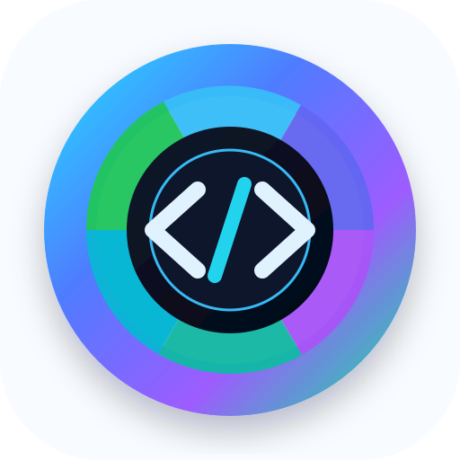
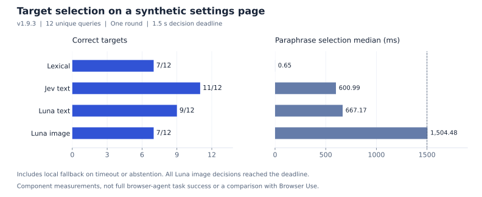
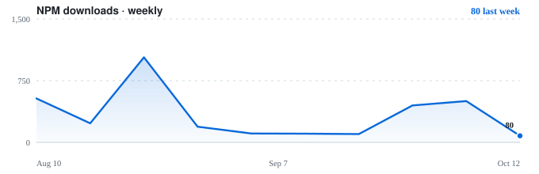

<p align="center"></p>
<h1 align="center">OpenCode Browser Plugin</h1>
<p align="center">Your browser, connected to your coding agent.<br>Four compact tools. Local action memory. Optional decision assistance.</p>
<p align="center">
<a href="https://www.npmjs.com/package/opencode-chromium"></a>
<a href="https://www.npmjs.com/package/opencode-chromium"></a>
<a href="https://github.com/Quindart-com/opencode-chromium/discussions"></a>
</p>
<p align="center">
<a href="https://chromewebstore.google.com/detail/opencode-chromium/hdljmmpfnhojebplbbgdgejoobmjcbml"></a>
<a href="https://addons.mozilla.org/firefox/addon/opencode-browser-plugin/"></a>
</p>

## Get started

Install the matching browser extension, then connect all detected supported harnesses and native hosts:

```sh
npx -y opencode-chromium@latest setup --all
```

Setup shows what changed and keeps transactional backups. Preview with `--dry-run --json`. Quit and reopen desktop harnesses, or reconnect MCP in terminal clients. **Firefox and LibreWolf also require launching with remote debugging enabled**; see the [Firefox launch instructions](#firefox-agent-setup).

<details><summary><strong>Codex CLI and Codex Desktop</strong></summary>

```sh
npx -y opencode-chromium@latest setup --targets codex
```

Both use the shared Codex MCP configuration. A native Codex plugin bundles the MCP server and browser skill; see the [Codex guide](docs/codex.md#native-plugin) for marketplace installation.
The marketplace can track GitHub directly; no local clone is required. See [updates and startup recovery](docs/codex.md#marketplace-updates-and-recovery) if Codex shows an older version or loads the skill without browser tools.
</details>
<details><summary><strong>Claude Code</strong></summary>

```sh
npx -y opencode-chromium@latest setup --targets claude-code
```
</details>
<details><summary><strong>Claude Desktop</strong></summary>

```sh
npx -y opencode-chromium@latest setup --targets claude-desktop
```

Supported setup targets: Windows and macOS.
</details>
<details><summary><strong>OpenCode</strong></summary>

```sh
npx -y opencode-chromium@latest setup --targets opencode
```

Uses the native adapter by default and the detected version's configuration format. [OpenCode guide](docs/opencode.md).
</details>
<details><summary><strong>DeepSeek Harness</strong></summary>

```sh
npx -y opencode-chromium@latest setup --targets dsh
```

Registers MCP in the Cordis profile patch. [Harness guide](docs/universal-clients.md).
</details>
<details><summary><strong>Generic MCP client</strong></summary>

Add this stdio server to your client's MCP configuration:

```json
{
  "mcpServers": {
    "browser": {
      "command": "npx",
      "args": ["-y", "opencode-chromium@latest", "mcp"]
    }
  }
}
```

[Full MCP guide](docs/mcp.md).
</details>
<details><summary><strong>JavaScript SDK</strong></summary>

```sh
npm install opencode-chromium
```

```js
import { createBrowserAgent } from "opencode-chromium/sdk";
```

[SDK examples and lifecycle](docs/direct-sdk.md).
</details>

## Choose your browser

<p>
<a href="https://www.google.com/chrome/"></a>
<a href="https://www.microsoft.com/edge/download"></a>
<a href="https://brave.com/download/"></a>
<a href="https://www.chromium.org/getting-involved/download-chromium/"></a>
<a href="https://www.firefox.com/download/"></a>
<a href="https://librewolf.net/installation/"></a>
</p>

| Browser family | Connection | Setup |
| --- | --- | --- |
| Chrome, Edge, Brave, Chromium | Chromium extension and CDP | Store extension + native host |
| Firefox, LibreWolf | Firefox extension and WebDriver BiDi | Signed add-on + native host + Remote Agent enabled at launch |

Desktop discovery covers Windows, macOS, and Linux. Firefox requires version 140 or later; LibreWolf must expose the matching Remote Agent. Compatible derivatives need individual validation; this does not claim support for every fork. See [Firefox capabilities](docs/firefox.md) and [compatibility](docs/compatibility.md) for transport differences and verification limits.

Named profiles choose the browser. Agents keep the same four tools: `browser_run`, `browser_observe`, `browser_session`, and `browser_finalize`. Sessions own their tabs, targets are checked against the live page, and uploads require confirmation by default. [Profiles](docs/profiles.md) · [Security](docs/security.md).

Finalization leaves every tab open in a blue group for human review. Existing pages can be claimed with the user's permission, provided they are ungrouped and unclaimed; tabs in another agent's group are excluded.

<details><summary><strong>Visual checks, frames and debugging</strong></summary>

Optional capability packs provide snapshot/pixel diffs, bounded frame inspection, experimental WebMCP discovery, detailed network and console inspection, and Chromium performance traces. Agents request these descriptions when needed, so the default tool list stays compact. Sessions can name their tab groups for the task. [Examples and limits](docs/mcp.md#optional-capabilities).

</details>

## Measured target selection



On this small fixture, Jev selected 11/12 targets, Luna text 9/12 and lexical search 7/12. Luna image calls reached the existing 1.5-second deadline and fell back locally. These are component measurements on one synthetic page, not complete browser-agent task success or a ranking against Browser Use. Exact matches skipped paid calls; missing cost reports remain unknown. [Results and methodology](assets/benchmarks/accuracy-1.9.3.json).

<details><summary><strong>Reproduce the benchmark</strong></summary>

```sh
bun run benchmark:accuracy
```

The default runs locally without paid requests. Add `--cloud` to compare Jev text, Luna text and Luna image using your configured OpenRouter key in isolated temporary settings. That experiment makes at most 18 requests and can incur charges. It does not change your saved provider choice. Candidate-pool misses, abstentions and timeouts remain in the score.

</details>

<a id="firefox-agent-setup"></a>
<details><summary><strong>Firefox and LibreWolf: enable remote debugging for agent control</strong></summary>

**Firefox-based browsers require the Remote Agent to be enabled at launch.** The add-on alone cannot provide the browser-level control used by this plugin: Firefox does not expose Chromium's debugger extension API. The plugin therefore uses WebDriver BiDi for trusted clicks, keyboard input, and native dialogs. Installing the add-on or opening Developer Tools does not enable this connection.

1. Install the Firefox add-on, run the setup command above, and connect the extension. Copy the Firefox/LibreWolf **profile ID** from the extension's **Profiles** section.
2. Replace `PROFILE_ID` below with that ID and configure the local connection:

   ```sh
   npx -y opencode-chromium@latest firefox configure --profile PROFILE_ID --port 9223
   ```

3. Finish active agent sessions and fully exit the selected browser. Relaunch it with `--remote-debugging-port 9223`, using the same browser profile that registered the extension. Adding the flag while the browser is already running does not enable the Remote Agent.

   **Windows — PowerShell** (adjust the executable path if installed elsewhere):

   ```powershell
   & "C:\Program Files\Mozilla Firefox\firefox.exe" --remote-debugging-port 9223
   # Or LibreWolf:
   & "C:\Program Files\LibreWolf\librewolf.exe" --remote-debugging-port 9223
   ```

   **macOS — Terminal:**

   ```sh
   /Applications/Firefox.app/Contents/MacOS/firefox --remote-debugging-port 9223
   # Or LibreWolf:
   /Applications/LibreWolf.app/Contents/MacOS/librewolf --remote-debugging-port 9223
   ```

   **Linux — Terminal:**

   ```sh
   firefox --remote-debugging-port 9223
   # Or LibreWolf:
   librewolf --remote-debugging-port 9223
   ```

4. Check that the configured port is reachable, then select the matching named profile in your agent:

   ```sh
   npx -y opencode-chromium@latest firefox status --profile PROFILE_ID
   ```

The status command checks port reachability; the extension verifies the browser/tab identity when automation attaches. Repeat the launch flag whenever you start the browser for agent use. For multiple profiles, use a separate port per running browser instance and configure each extension profile accordingly.

Keep remote debugging bound to loopback; do not expose its port to your network. Other local programs can access the Remote Agent, so a dedicated automation profile is recommended. To stop remote debugging, fully exit the browser and relaunch without the flag. See [Firefox setup and troubleshooting](docs/firefox.md) and [Mozilla's Remote Agent security documentation](https://firefox-source-docs.mozilla.org/remote/Security.html).

</details>

## A calmer operating panel

**Overview** shows the local connection, selected decision model, and memory status, with setup guidance when disconnected. **Profiles** lets you name and copy the profile for your agent. **Settings** holds decision assistance, uploads, memory retention, and advanced controls. Detailed usage, timings, and storage controls expand when you need them, with consistent widths and automatic light and dark themes.

Cloud assistance is off by default. Choose Jev through OpenRouter or TypeSafe, or OpenAI Luna through OpenRouter. Separately opt in to bounded screenshots for visual decisions. Jev's experimental image fallback runs only after an unsure text answer, with persistent request caps. Exact matches stay local; timeouts and abstentions retain local results. [Decision assistance, costs and limits](docs/DECISION-PROVIDERS.md) · [Local action memory](docs/action-memory.md).

## Updates

Extension updates open [what’s new](https://quindart-com.github.io/opencode-chromium/updates/) once per version in a background tab. Turn this off in the extension’s setup guide.

Published CLI installations set up with `setup --all` can keep their managed runtime aligned automatically. The extension triggers a background download of its matching npm release. Activation waits until **every agent's browser session across all connected profiles has finished**, then replaces MCP workers while keeping harness connections open. New work stays available while an update waits; incoming calls briefly queue during the final switch. Handoff tabs, approvals and incomplete cleanup continue to block activation. **Settings → Updates** shows selected, downloaded and loaded versions. Existing installations need one setup and MCP reconnection to adopt this flow. OpenCode's native adapter still requires reloading to pick up new adapter code. Development checkouts and explicit pins stay manual; global npm installations are not overwritten. CLI controls: `opencode-chromium updates status`, `updates on`, or `updates off`. Unavailable npm releases are retried after six hours. See [automatic updates](docs/runtime-updates.md) for compatibility and recovery details.

## npm downloads

<picture>
  <source media="(prefers-color-scheme: dark)" srcset="assets/npm-downloads-dark.svg">
  
</picture>

The scheduled chart workflow refreshes these assets. npm download counts are package downloads, not unique users or extension installs.

<details><summary><strong>Manage, update, and troubleshoot</strong></summary>

```sh
npx -y opencode-chromium@latest setup --all --dry-run --json
npx -y opencode-chromium@latest setup --targets codex,opencode
npx -y opencode-chromium@latest manage
npx -y opencode-chromium@latest doctor --json
npx -y opencode-chromium@latest status --json
npx -y opencode-chromium@latest uninstall --targets codex
```

Use `--config harness-id=/absolute/path` for a custom configuration. Existing aliases, package names, profiles, and runtime data remain supported. [Troubleshooting](docs/troubleshooting.md).

The extension distinguishes a responding local bridge from harness connections. Its connection panel shows observed agent links, versions and heartbeat health, with guarded disconnect/reconnect controls and a CLI doctor command. See [connection health](docs/connection-health.md).
</details>

<details><summary><strong>Develop and release</strong></summary>

```sh
bun install --frozen-lockfile --ignore-scripts
bun run build
bun run build:extension
bun run build:extension:firefox
bun run check
bun run check:firefox
```

Both extensions share WXT/React source. Separate output directories prevent one build replacing the other. Forward version bumps on `master` trigger npm and store release workflows. Mozilla submissions can remain pending review before publication. [Architecture](docs/architecture.md) · [Firefox publishing](docs/firefox.md).

For a stale unpacked extension, run `bun src/cli/index.ts dev-extension --source /absolute/checkout --output /absolute/loaded/extension`, then reload it in the browser. This refreshes the existing extension path and labels the build with its source fingerprint while retaining production runtime selection. See [local development builds](docs/connection-health.md#refresh-a-stale-unpacked-extension).
</details>

Questions and ideas: [Discussions](https://github.com/Quindart-com/opencode-chromium/discussions). Bugs: [Issues](https://github.com/Quindart-com/opencode-chromium/issues). [MIT license](LICENSE).
