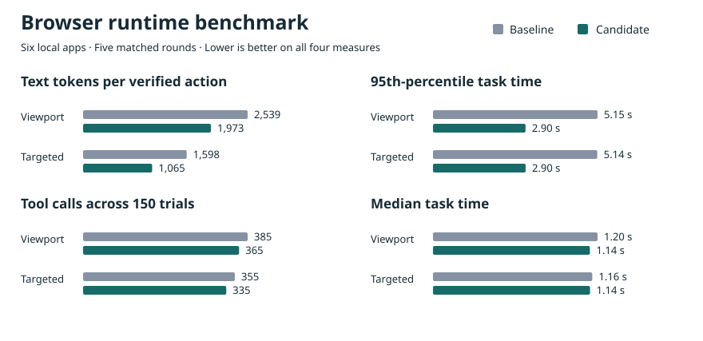

# Browser read and routing comparison

The development runtime reduced targeted tool text by 33% and targeted 95th-percentile task time by 44%. Both releases verified all 140 eligible actions, all 35 held-out actions and all 10 guard cases in each policy. Neither produced a wrong or extra effect.



| Five rounds on six local apps | Viewport baseline | Viewport candidate | Targeted baseline | Targeted candidate |
| --- | ---: | ---: | ---: | ---: |
| Tool-text tokens per verified action | 2,539 | 1,973 | 1,598 | 1,065 |
| Total action-phase tool calls | 385 | 365 | 355 | 335 |
| Median task time | 1.20 s | 1.14 s | 1.16 s | 1.14 s |
| 95th-percentile task time | 5.15 s | 2.90 s | 5.14 s | 2.90 s |
| Initial tool schema tokens | 2,831 | 1,763 | 2,831 | 1,763 |

Each policy used 150 trials in the original harness with the same seed, fixture hashes, browser binary, input mode and tokenizer. The release measurements ran at different times on one machine. Treat small median timing differences as indicative. Text-token counts include tool arguments and returned text. They exclude model reasoning and image input. The actions ran locally with no hosted reads or decision-model requests.

**Where the savings came from.** Returning the exact record matches together kept the alternatives for the requested record and avoided one oversized artifact retrieval per iframe checkout. For targeted checkout, text tokens per verified action fell from 6,149 to 2,377. On constantly changing pages, the runtime now returns an explicit unsettled result when it observes sustained changes during an implicit wait. Explicit settle requests retain their deadline. The fixture verified the actual effect separately.

**Read safety.** The same ten admission cases improved from 9/10 to 10/10. A request for story 8863 from a tab displaying story 1 now stops locally, before transport. The hosted path checks the returned fields, resource and current grant before returning a public answer. A separate live smoke test verified the exact title of public story 1 through the development Convex deployment. The frozen plain-viewport probe showed the numeric answer on 5/8 applicable tasks in both builds. The other three required a targeted row, following a link, or pixels.

**Luna on low effort.** The model chose a plain read for every task on the frozen release. The parent executed its calls on the real fixtures and relayed the observations. Luna answered 7/10 correctly. It missed the offscreen invoice, used a saved value for the live timetable and returned the canvas heading. Replaying the same calls and answers on the candidate also scored 7/10. Attempts to start a fresh candidate operator produced no tool calls. The scored trials therefore do not establish an autonomous accuracy gain.

As a separate test, a fixed workflow chose the relevant row, followed the current timetable link, and captured the canvas. Luna read the resulting evidence and answered 9/10 across 11 calls. It returned unknown for the screenshot. The frozen 10/10 result used the fixture author on a different model. These scores measure different operators and levels of guidance.

**Scope.** The available public provider covers Hacker News. This experiment used synthetic local browser tasks and inspected offline admission decisions. It does not measure generalized cross-site routing, contribution transfer between users, or a per-call Convex cost reduction. Fresh public reads still contact the provider. Local page reads work independently of the registry.

## Reproduce the comparison

The two per-attempt evidence archives are kept outside the repository. Extract both into one folder, then run the following commands with the extracted directories. The comparison script checks fixture matching and errors on accuracy or isolation regressions.

```sh
node benchmarks/reading/compare-releases.mjs <routing-baseline-v1> <routing-final-v1> comparison.svg
node benchmarks/browser/compare.mjs <routing-baseline-v1>/targeted <routing-final-v1>/targeted
```

The archives contain the per-attempt logs, build fingerprints, and a marker for the matched runner pair. Workstation details and absolute timestamps were removed after matching the two environments. The sanitized archives reproduce the same chart. Agent trial categories are stored separately. An empty autonomous category means no independently operated trial was completed. The candidate was measured as an uncommitted change on top of `adc5580`. See the [baseline protocol](README.md) for replay instructions. For offline admission on the candidate set `OPENCODE_BROWSER_SITE_REGISTRY_ORIGIN=https://fixture-registry.convex.site`; the harness intercepts HTTPS before any request leaves the process.
