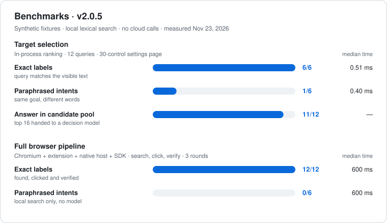

# Benchmarks

The benchmark reports verified effects, tool token estimates, action latency, and tab ownership on synthetic browser workloads.

## Verified actions

The Chromium full suite uses six local apps, including a 500-row invoice table, a form with multilingual input, cross-origin checkout, and a changing feed. Each round has 28 actions and two cases in which the driver must abstain. An independent fixture journal checks the intended effects and catches wrong or extra changes. Timers start at the task and include navigation, discovery, action, and verification.

Five alternating trials on Chromium 158.0.8127.18 used the managed MCP launcher and the same targeted-read policy on master `b3b6e80` and evaluation commit `aebfc47`. Tool tokens use `gpt-tokenizer@3.4.0` with `o200k_base`. The count includes tool arguments, returned text, failed attempts, and fetched artifacts.

| Build | Verified actions | Abstention | Estimated tokens per verified action | p50 | p95 |
| --- | ---: | ---: | ---: | ---: | ---: |
| Master | 130 / 140 | 10 / 10 | 1,789 | 1.45 s | 5.21 s |
| Evaluation | 140 / 140 | 10 / 10 | 1,620 | 1.23 s | 5.11 s |

Both arms recorded zero wrong and extra effects. Checkout actions were verified through the independent journal. The tool's top-level observation missed their in-frame confirmations in these trials. The changing feed accounted for the slowest actions on each build.

A separate one-round policy comparison on the evaluation version reduced estimated tokens per verified action from 2,568 to 1,636 by including the known record ID in the first read. Both policies verified all 28 actions. The same workflow also reduces token cost on master.

On stock Firefox 157.0.1, the five-action smoke suite verified 25 of 25 actions across five rounds on the evaluation build. Master verified zero. The evaluation rounds had a median trial p95 of 1.75 s and averaged 1,875 estimated tokens per verified action. Separate extension checks passed trusted input, deep reads with oversized multilingual values, and an approved reclaim and release.

## Shared browser

Five paired trials compared the evaluated admission implementation with `cd6d92e` on the same Chromium binary and extension. Each client opened its own tab in one disposable browser. The timed workload alternated search and click with read and fill.

| Clients | Previous p95 | Evaluation p95 | Previous verified actions/sec | Evaluation verified actions/sec |
| --- | ---: | ---: | ---: | ---: |
| 1 | 180 ms | 130 ms | 7.70 | 13.71 |
| 4 | 474 ms | 117 ms | 12.03 | 42.91 |
| 8 | 1,044 ms | 217 ms | 11.61 | 46.95 |

Eight clients reached 1.67× single-client p95. Both arms verified 520 actions, denied 10 cross-tab attempts, and recorded zero timeouts, duplicates, or browser focus losses. Separate waves at 1, 2, 4, 8, and 16 clients verified all 620 healthy and slow-tab actions on the evaluation build. At sixteen clients, the two healthy waves measured 505–563 ms p95.

The evaluator includes the CI smoke workload, repeat command, reports and comparison protocol. [Benchmark commands](../benchmarks/browser/README.md)

## Comparison with other browser tools

Five interleaved trials per tool ran the same seeded 30-case workload on Chromium 158.0.8127.18. All three verified 140 actions, passed 10 abstention checks, and recorded zero wrong or extra effects. OpenCode used its managed extension profile and targeted reads. The comparators used isolated Chromium launchers and accessibility snapshots.

| Tool | Tool calls | Estimated tokens per verified action | Verified p50 | Verified p95 | Median session |
| --- | ---: | ---: | ---: | ---: | ---: |
| OpenCode evaluation `603d40c` | 355 | 1,617 | 1.24 s | 5.12 s | 56.27 s |
| Playwright MCP 0.0.86 | 590 | 5,915 | 1.15 s | 1.57 s | 33.83 s |
| Chrome DevTools MCP 1.13.0 | 590 | 8,072 | 0.44 s | 6.22 s | 38.19 s |

The percentiles pool each tool's 140 verified actions. The session times include setup and cleanup, including browser launch. Tool token estimates cover arguments and returned text. All 140 OpenCode actions also returned a confirmation, including the framed checkout cases. Playwright had the lowest p95 and Chrome DevTools had the lowest median on this workload.

The changing-feed pages updated every 90 ms. OpenCode's navigation and click calls on those pages each took about 2.5 s, matching the default cap on waiting for a quiet DOM. [Default action settling](../src/core/settling.ts) · [Fixture definitions](../benchmarks/browser/catalog.mjs)

### Existing browser tabs

| Tool and connection | Approval and ownership observed on disposable Chromium |
| --- | --- |
| OpenCode managed extension | The tool requires approval bound to the selected tab, profile and session. Two competing approvals yield one owner. Claim, release and expiry keep the page open. |
| Playwright MCP with Playwright Extension 0.6.0 | The first call waited for the real tab picker. The post-approval tab list showed the chosen fixture. The prompt also disclosed broader profile data access. The selected tab and its neighbor stayed open after disconnect. |
| Browser MCP 2.5.0 with its extension 2.2.3 | The popup required matching six-digit codes and **Allow**. An already-open fixture could then be selected and acted on. The connection refused to close that tab and could open and close a background tab of its own. |
| Chrome DevTools MCP with loopback CDP | The test connected to a preconfigured endpoint, reused the exact fixture tab and retained it after disconnect. Chrome's documented `--autoConnect` path has its own permission prompt. |

Playwright extension approval used Microsoft's fixture launcher approach when the stock secondary launch failed to open the picker on headless Windows. Playwright MCP and Chrome DevTools MCP each passed the separate bounded CDP smoke test. The measured multi-client load rows cover OpenCode. [Playwright Extension](https://github.com/microsoft/playwright/tree/main/packages/extension) · [Browser MCP](https://github.com/BrowserMCP/mcp) · [Chrome DevTools connection modes](https://github.com/ChromeDevTools/chrome-devtools-mcp/blob/main/docs/advanced-usage.md)

The preopened invoice fixture provides a smaller comparison. The clock starts after permission is granted and ends when its independent journal verifies the effect. Each comparator row represents one run. OpenCode's trusted click was sampled twice after the background movement change.

| Tool and mode | Wall time | Estimated action tokens | Verified event |
| --- | ---: | ---: | --- |
| OpenCode default input | 0.86 s | 594 | DOM click |
| OpenCode explicit pointer | 1.14–1.19 s | 598–603 | Trusted click |
| Playwright Extension | 1.25 s | 5,501 | Trusted click |
| Browser MCP | 0.74 s | 4,267 | Trusted click |

Previously, explicit pointer mode took 5.31–7.13 s in the same fixture. The trace spent 5.15 s waiting on eight Chromium mouse commands. One movement followed by the trusted press and release reduced the wait while preserving the verified effect and both open tabs.

## CPU and resident memory

The Windows comparison used Node 24.22.2 with clean installations of `603d40c` and `786ca1e`. Each CLI command ran seven times per build in alternating order. The table reports median CPU time and peak resident memory per process. [Node process resource measurements](https://nodejs.org/docs/latest-v24.x/api/process.html#processresourceusage)

| Command | CPU before | CPU after | Peak memory before | Peak memory after |
| --- | ---: | ---: | ---: | ---: |
| `diagnostics summary` | 264 ms | 140 ms | 61.4 MiB | 53.3 MiB |
| `updates status` | 203 ms | 46 ms | 59.2 MiB | 46.9 MiB |
| `mcp --help` | 905 ms | 718 ms | 113.2 MiB | 104.2 MiB |

Three paired managed Chromium sessions per build ran the five-action smoke suite with memory and decision assistance disabled. All 15 actions verified on each build. Across the broker, native host, MCP supervisor and MCP worker, CPU per verified action fell from a median of 268 ms to 184 ms. Median workload time fell from 10.29 s to 9.89 s.

The sum of the four process working sets moved from 325 to 330 MiB after setup and from 303 to 269 MiB after the workload. These samples exclude the browser processes and can include shared pages. The post-workload readings varied by trial. The CLI loads setup and HTTP modules on demand. Automatic settling schedules its next read using the latest mutation age and still requires a full 500 ms quiet window. [Settling implementation](../src/core/settling.ts)

One matched full Chromium run verified 28 of 28 actions and passed both abstention guards on each build, with zero wrong or extra effects. Median action time moved from 1.21 s to 1.14 s. The p95 was about 5.12 s on both builds. Tokenizer-estimated MCP tokens per verified action rose from 1,612 to 1,644 in this pair. [Verified-action harness](../benchmarks/browser/README.md)

## Decision-model context and token cost

Six synthetic requests paired identical control labels across different sections or enabled states. The local candidate order and the 16-choice limit were fixed across arms. Both arms used `typesafe/jev-1.13-20260917` over OpenRouter with text input. The earlier request used opaque node IDs. The compact request used short IDs and retained the nearest section and disabled state. [Model and usage fields](https://openrouter.ai/typesafe/jev-1.13-20260917)

| Metric | Earlier request | Compact request |
| --- | ---: | ---: |
| Correct first result | 0 / 6 | 4 / 6 |
| Provider abstentions | 6 / 6 | 2 / 6 |
| Mean reported input tokens | 1,325 | 716 |
| Mean reported output tokens | 900 | 164 |
| Decision p50 | 558 ms | 559 ms |
| Slowest decision | 738 ms | 961 ms |

The provider reported $0.00051429 for the 12 requests. This fixture tests disambiguation inside an existing candidate pool. The two uncertain cases retained the local ranking. [Decision request and response mapping](../native-host/src/decisions/search.ts)

## Published ranker and SDK results

<picture>
  <source media="(prefers-color-scheme: dark)" srcset="../assets/benchmarks/summary-dark.svg">
  
</picture>

**Version 2.0.5 · measured November 23, 2026** on Windows with Bun and Node 22.

### Target selection (in-process)

The local ranker picks one control for each of 12 queries on a 30-control settings page. Raw data: [`accuracy.json`](../assets/benchmarks/accuracy.json).

| Query type | Correct top result | Median time |
| --- | ---: | ---: |
| Exact label, such as "save changes" | **6 / 6** | 0.51 ms |
| Paraphrase, such as "make the page easier on the eyes at night" | **1 / 6** | 0.40 ms |
| Correct answer among the top 16 candidates | **11 / 12** | — |

### Full browser pipeline

A disposable Chromium with the extension, native host and SDK searches the page, clicks the top result and checks the page state. There are 6 tasks and 3 rounds. Raw data: [`pipeline.json`](../assets/benchmarks/pipeline.json).

| Task type | Found, clicked and verified | Median time per task |
| --- | ---: | ---: |
| Exact or near-exact label | **12 / 12** | 600 ms |
| Paraphrase ("stop notifications" → *Mute alerts*) | **0 / 6** | 600 ms |

Each task takes two tool calls (`browser_observe` and `browser_run`) and returns about 2.8 KB.

### Lexical search throughput

150 searches over 500 synthetic controls in one process, median of 3 runs:

| p50 | p95 | Result hash |
| ---: | ---: | --- |
| 2.4 ms | 4.3 ms | `bbd246fd…3671d` (unchanged means identical rankings) |

### What this means

- **Exact labels are reliable and cheap.** Local search finds them in under a millisecond, with no model.
- **Paraphrases need help.** Local lexical search rarely matches a request that shares no words with the label. The correct target is still in the candidate pool 11 times out of 12, so an optional [decision provider](DECISION-PROVIDERS.md) can rerank it. Run `--cloud` to measure that.
- **Most pipeline time is spent in the browser, not in ranking.** Ranking takes under 1 ms of the roughly 600 ms per search-and-click task.

## Benchmark suite

| Command | What it measures | Needs | Cost |
| --- | --- | --- | --- |
| `bun run benchmark:accuracy` | Top-1 target accuracy and latency of the local ranker on the fixed 12-query fixture | Nothing | Free |
| `bun run benchmark:accuracy -- --cloud` | The same fixture with Jev text, Luna text and Luna image decisions in isolated temporary settings | An OpenRouter key | ≤ 18 paid requests |
| `bun run benchmark:lexical` | Ranking speed, CPU and a result hash over 500 controls | Nothing | Free |
| `bun run benchmark:production` | Search, click and verification through a real extension, native host and SDK | A build and Playwright Chromium | Free |
| `bun run benchmark:heldout` | Extraction, local ranking and clicks on a separate fixture; can compare another ranker build | A connected browser | Free |
| `bun run benchmark:flow` | Latency of a fixed tool sequence, with final-state checks | A connected browser | Free |
| `bun run benchmark:decisions` | Calls, tokens and cost of the decision pipeline as a real search would incur them | A configured provider | Paid |
| `bun run benchmark:decisions:capped` | Direct Jev compared with Luna text decisions, under a hard $5 limit | An OpenRouter key | Paid, capped |
| `node scripts/benchmark-memory-threshold.js` | Similarity threshold for action-memory recall on the calibration pairs | Nothing | Free |

Recorded result: threshold 0.63 with 0.67 recall and no false positives on 6 positive and 6 negative pairs.

## Running them

### Local, no browser

```sh
bun run benchmark:accuracy          # writes reports/benchmark-accuracy.json
bun run benchmark:lexical
node scripts/benchmark-memory-threshold.js
```

### Real browser

```sh
bun run build && bun run build:extension
npx playwright install chromium     # once
bun run benchmark:production reports/production.json 3    # report path, rounds 1–10
```

`benchmark:production` runs under Node on purpose: on Windows, starting the Playwright fixture under Bun can stall. It uses a temporary profile and a uniquely named native host, so it never touches your installed browser, host or provider settings.

`benchmark:heldout -- --out reports/heldout.json --rounds 2 [--ranker PATH]` and `benchmark:flow` use the browser your runtime is already connected to. To compare two revisions, build each checkout separately and run the same command under similar conditions.

### Cloud decision models (paid)

```sh
bun run benchmark:accuracy -- --cloud
bun run benchmark:decisions:capped -- reports/decision-run.json   # path must not exist yet
```

- `--cloud` reuses your saved OpenRouter key in a temporary provider directory. It makes at most 18 requests and does not change your saved provider choice.
- `decisions:capped` checks current catalog prices and reserves $0.20 of a $5 budget before each request. It stops if a response omits usage or cost. Aborted requests stay reserved, because they may still be billed.

## Updating the published results

```sh
bun run benchmark:accuracy
bun run build && bun run build:extension
bun run benchmark:production reports/production.json 3
cp reports/benchmark-accuracy.json assets/benchmarks/accuracy.json
cp reports/production.json assets/benchmarks/pipeline.json
bun run benchmark:chart             # redraws summary.svg and summary-dark.svg
```

Then update the tables and the date at the top of this page. Each report records the package version, time, fixture hash and source fingerprints, so its numbers can be traced to the code that produced them.

## Limits

- **Small, synthetic fixtures.** 12 queries and 6 tasks cannot establish general accuracy. These numbers are not WebVoyager scores, full agent task success rates or comparisons with other browser agents.
- **No agent planning.** Every benchmark issues fixed queries; none measures how a model chooses what to do next.
- **Noisy timings.** Single rounds, browser scheduling and the first network connection all add variance. Compare revisions on the same machine and check the result hash.
- **Decision models only rerank.** A target missing from the local candidate pool cannot be recovered, even with a screenshot.
- **Cost may be incomplete.** Providers do not always report usage, and cancelled requests can still be charged.

Committed reports must contain synthetic labels only. Never commit credentials, browser profile IDs, real page content or local paths; keep private raw reports in the ignored `reports/` folder.

## Past investigations

- [Decision latency, October 2026 (v1.10.x)](benchmarks/decision-latency.md): text-first screenshot fallback, the Node connection-timeout fix and live provider timings.
