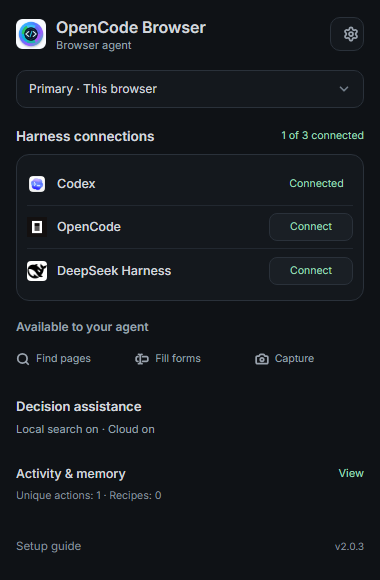
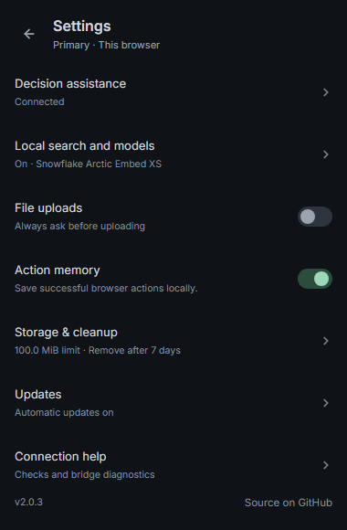
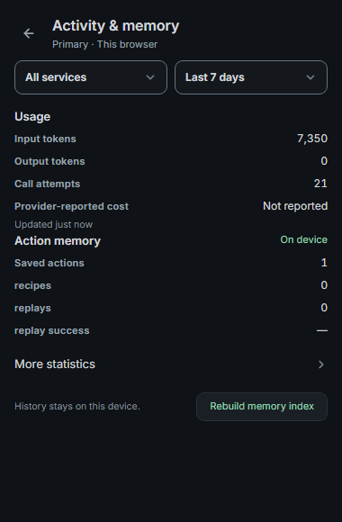
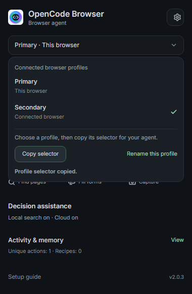
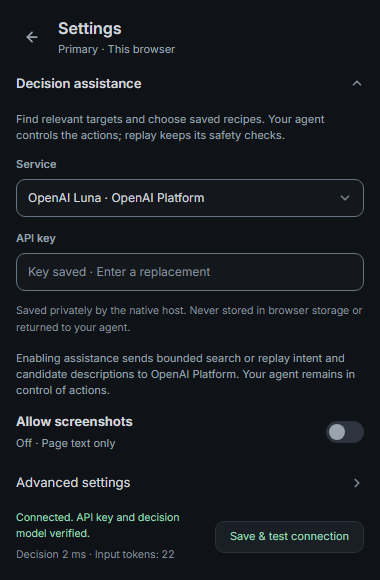
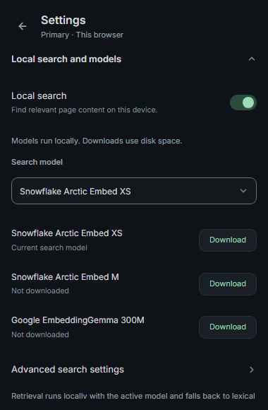

# Compact extension popup

The popup uses one Home screen, a Settings button, an Activity & memory view, and a profile selector. Installed or responding harnesses appear in aligned rows; healthy connections use plain green status text.

The native toolbar popup stays inside the browser extension. Detailed forms scroll beneath their heading. Provider save feedback stays visible at the bottom. Existing connection, model, storage, consent, and runtime update APIs continue to supply the controls.

## Review images

These PNGs come from the synthetic popup verification fixture. They contain example profile labels, fabricated usage, mocked provider responses, and no personal browser data, profile identifiers, local paths, browsing history, or live credentials. The password field in the error example contains a generated test value.

| Home | Settings | Activity |
| --- | --- | --- |
|  |  |  |

| Profiles | Decision assistance | Local models |
| --- | --- | --- |
|  |  |  |

Additional examples: [profile settings](images/extension/profile.png), [provider error](images/extension/provider-error.png), [bridge unavailable](images/extension/disconnected.png), [summary retry](images/extension/summary-unavailable.png), [settings retry](images/extension/settings-unavailable.png), and [a long profile list](images/extension/profiles-many.png).

## Verification and local review

```sh
bun run build
bun run build:extension
node scripts/verify-popup.js
node scripts/verify-native-popup.js
```

`verify-popup.js` checks the compact navigation, row alignment, profile copy and rename, scoped memory totals, usage filters, provider key failure and success, screenshot consent, upload confirmation, model settings, storage changes, connection checks, update recovery, and major-version approval. It also checks failed-summary retries, a scrollable list with twelve additional long-label profiles, and all six shipped languages at 320px and 380px. Use `--screenshots` to regenerate the synthetic images above.

`verify-native-popup.js` uses an isolated Chromium profile and a unique disposable native-host registration. It verifies the built extension against the real native bridge and checks that the toolbar action opens its popup without a regular tab.

Load the `extension` directory through Chromium’s **Load unpacked** command. To refresh an existing stable development path, use the documented `dev-extension` command in [runtime updates](runtime-updates.md). Reload the extension after rebuilding.
